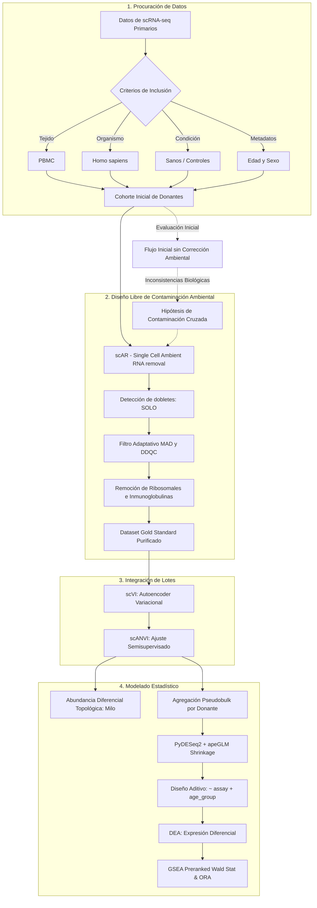
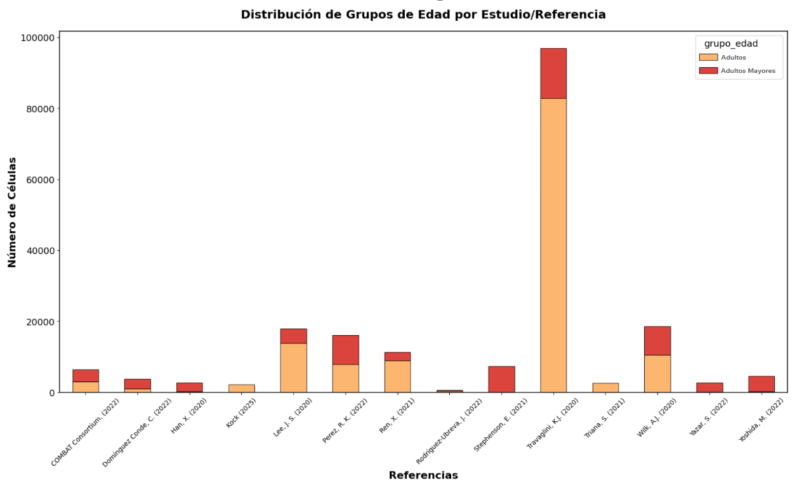
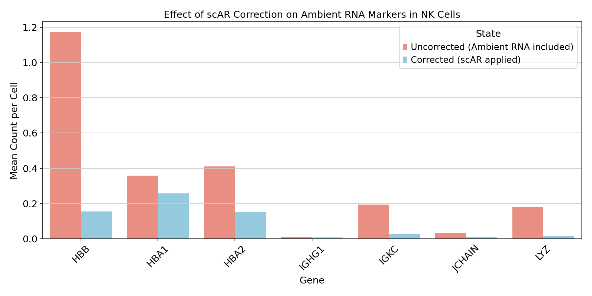
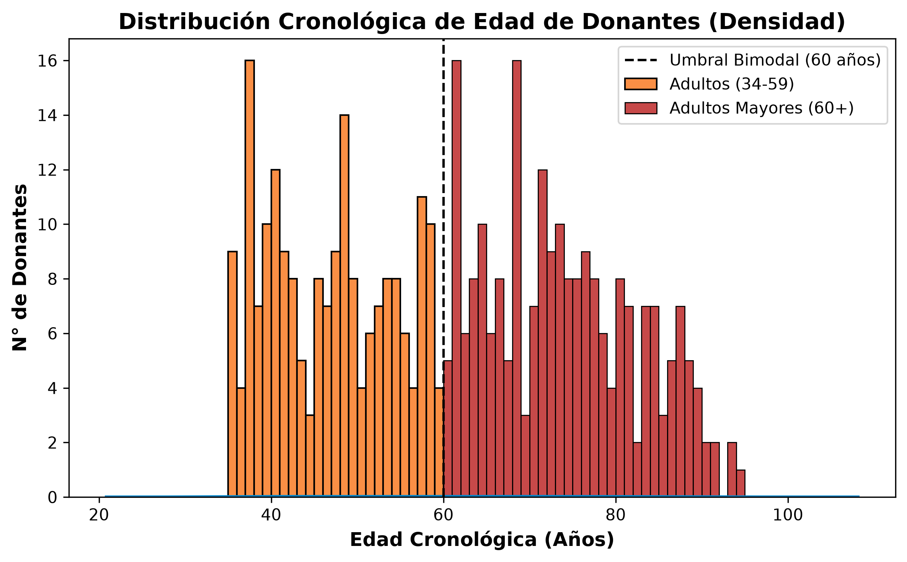
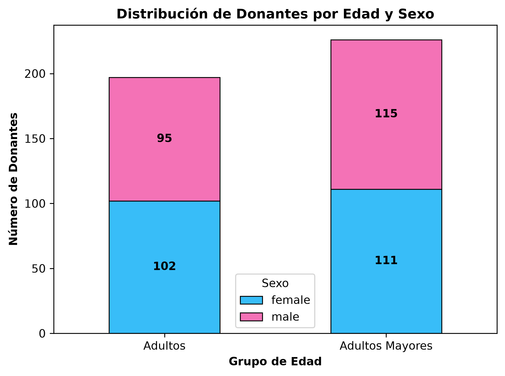
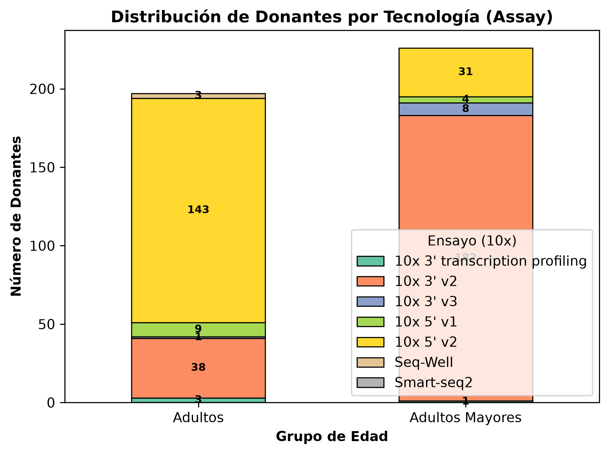
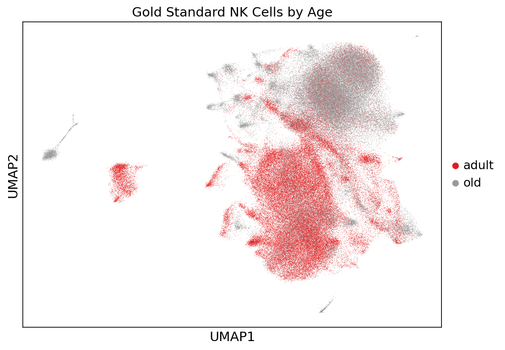
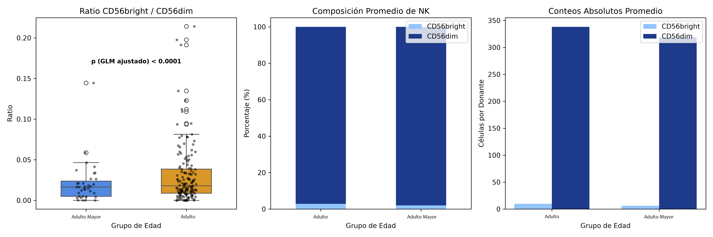

# 4. Metodología

## 4.1 Recolección y Preprocesamiento de Datos

El análisis se realizó con datos de tipo scRNA-seq obtenidos del repositorio *CellxGene* Census (CZ CELLxGENE, 2023), restringiendo la búsqueda a muestras de tejido sanguíneo humano provenientes de donantes sanos. Para el procesamiento y análisis computacional se emplearon rutinas desarrolladas en Python (versión 3.9.7).

La selección de las muestras se rigió por criterios de inclusión y exclusión diseñados para garantizar la calidad y la relevancia biológica del estudio. Se incluyeron únicamente datos primarios de donantes sanos con edades iguales o superiores a 34 años, cuyas células estuvieran anotadas específicamente como células Natural Killer (NK) o sus subtipos, y que contaran con metadatos completos referentes a edad y sexo. Por contraparte, se excluyeron aquellos datos provenientes de tejidos distintos a la sangre periférica, de muestras de individuos sometidos a tratamientos farmacológicos, de donantes menores de 34 años, así como cualquier célula que careciera de una anotación clara o perteneciera a linajes celulares distintos.

Para caracterizar los cambios asociados al envejecimiento, la cohorte se dividió en dos grupos de edad definidos con base en evidencia proteómica y clínica previa. El primer grupo, denominado "Adultos" (34-60 años), se estableció a partir del punto de inflexión molecular identificado a los 34 años en el proteoma plasmático (Lehallier et al., 2019). El segundo grupo, "Adultos Mayores" (>60 años), se definió con base en la misma evidencia de estudios proteómicos presentada por el mismo grupo de investigación y además considerando las definiciones integrales utilizadas por la Organización Mundial de la Salud (2011, como se citó en Varela Pinedo, 2016). Esta agrupación permitió observar el paso de una fase de mantenimiento homeostático en adultos hacia una fase de senescencia inmunológica esperada en adultos mayores.

Las anotaciones de tipos celulares fueron estandarizadas y agrupadas utilizando un diccionario de ontología celular a través del CellGuide (Chan Zuckerberg Initiative, s.f.) y posteriormente adaptado de estudios recientes de perfilado de células mononucleares de sangre periférica (Kian Hong Hu Y., et al., 2024). Esta estandarización permitió una comparación consistente entre conjuntos de datos a nivel de tipo celular, mientras se mantenía la granularidad de las clasificaciones de subtipos celulares. Para asegurar la calidad de los datos y la compatibilidad entre estudios, se implementó un proceso de homogeneización del espacio de características, convirtiendo todos los identificadores de genes a símbolos HGNC estándar y eliminando características duplicadas o ambiguas.

## 4.2 Evaluación del Flujo Inicial sin Corrección Ambiental

Se evaluó inicialmente un diseño analítico empleando filtros de calidad estándar, parcialmente inspirado por trabajos como los de Luecken M.D. et al. (2022) o Sanbomics (2022), pero con modificaciones orientadas al control de calidad (Subramanian, A., et al., 2022) y diseñado para el análisis de células NK adultas, buscando asegurar la confiabilidad de los datos mientras se conservaban las señales biológicas relevantes. No obstante, dicho enfoque reveló inconsistencias biológicas significativas, tales como la subexpresión asociada a la edad de cadenas de inmunoglobulinas —típicamente circunscritas al linaje de células B— y la sobreexpresión de factores inflamatorios normalmente asociados a neutrófilos. En consecuencia, se postuló la hipótesis de que dichas discrepancias derivaban de una contaminación por ARN ambiental, lo cual motivó su modificación para atender estas contradicciones mediante el desarrollo e implementación de un Diseño Experimental Libre de Contaminación Ambiental.

## 4.3 Diseño Experimental Libre de Contaminación Ambiental (scAR) y Control de Calidad

La integración de múltiples cohortes presentó el desafío del ARN libre o ambiental, derivado de la lisis celular durante la preparación de la suspensión unicelular. Dado que las matrices de datos carecían de los datos crudos de las gotas vacías (*empty droplets*), se empleó la herramienta *Single Cell Ambient RNA removal* (scAR) (Sheng et al., 2022) para mitigar esta contaminación cruzada. El algoritmo modela los conteos observados como una regresión binomial mixta compuesta por la señal biológica nativa y los artefactos técnicos ambientales, garantizando la eliminación del ruido a nivel de transcrito individual.

Tras la corrección probabilística, se implementó un control de calidad híbrido y riguroso. Se empleó SOLO, un método de detección de dobletes basado en aprendizaje profundo (Bernstein et al., 2020), implementado mediante el marco de trabajo scVI (scvi-tools, versión 1.1.5). Este enfoque fue seleccionado por su capacidad para manejar conjuntos de datos a gran escala y mantener la sensibilidad a las características de los tipos celulares. Las células fueron identificadas como dobletes si la puntuación de probabilidad diferencial entre predicciones de células dobletes y de célula única excedía 0.3 y las métricas de complejidad superaban el percentil 95. Adicionalmente, las métricas de calidad celular se calcularon utilizando un enfoque adaptativo fundamentado en la Desviación Absoluta de la Mediana (MAD).

Adicionalmente, la remoción del ARN ambiental reveló una distribución bimodal en el número de genes detectados por célula (`n_genes`). Esta bimodalidad no reflejaba una división biológica subyacente, sino que se originó por un sesgo técnico inherente a las diferentes tecnologías de captura (ej. 10x Genomics 3' v2 frente a 10x 3' v3). Un análisis de partición de varianza corroboró que la variable tecnológica (`assay`) explicaba la mayor proporción de la varianza total, identificándose a los transcritos ribosomales y las inmunoglobulinas espurias como los principales conductores de este sesgo. Para mitigar este fenómeno y depurar la matriz, se aplicó un filtrado declarativo excluyendo los genes ribosomales y la familia de inmunoglobulinas del cálculo de dispersión.

## 4.4 Integración de Datos y Reducción de Dimensionalidad (scVI y scANVI)

La integración de estudios independientes requirió un enfoque en dos etapas para corregir los efectos de lote (*batch effects*) y preservar la variación biológica relacionada con el envejecimiento.

La primera etapa de integración se realizó mediante scVI (*single-cell Variational Inference*), un modelo de *autoencoder* variacional que comprime los datos de expresión génica a un espacio latente de baja dimensión. El modelo aprende a corregir los efectos técnicos del lote, generando una representación unificada de los datos provenientes de múltiples estudios. 

Posteriormente, se refinó la integración mediante scANVI (*Single-cell ANnotation using Variational Inference*), una extensión con enfoque semisupervisado que incorpora información de etiquetas celulares conocidas para asistir en la separación de la variación biológica respecto a los artefactos técnicos. Esta etapa ajustó la matriz latente, corrigiendo las discrepancias originadas por el estudio fuente y otras covariables técnicas. La evaluación de calidad mediante el marco scIB confirmó la eliminación eficaz de los efectos de lote.

## 4.5 Análisis de Abundancia Diferencial Topológico (Milo)

Para modelar la dinámica poblacional y los cambios en las proporciones de los subtipos NK a lo largo del envejecimiento, se implementó el entorno estadístico Milo (Dann et al., 2020). A diferencia de las aproximaciones clásicas fundamentadas en clústeres discretos —las cuales introducen sesgos analíticos al forzar particiones en gradientes celulares continuos— Milo evalúa la abundancia diferencial modelando los estados celulares como vecindarios (*neighborhoods*) parcialmente superpuestos sobre un grafo de k-vecinos más cercanos (k-NN).

En el presente estudio, se cuantificó el número de células en cada vecindario representativo y se empleó un Modelo Lineal Generalizado (GLM) Binomial Negativo para evaluar las diferencias de abundancia entre adultos y adultos mayores, incorporando la tecnología de captura (`assay`) en el modelo aditivo. Finalmente, se aplicó un control de Tasa de Falso Descubrimiento espacial (*Spatial FDR*) para mitigar el sesgo de pruebas múltiples asociado a la superposición celular.

## 4.6 Análisis de Expresión Diferencial Robusto (PyDESeq2 y apeGLM)

Para el análisis de expresión diferencial, se descartó el enfoque basado en célula única con el fin de prevenir la inflación de los valores *p*, implementándose en su lugar una estrategia de agregación por donante (*pseudobulk*). 

Este abordaje posibilitó el uso de PyDESeq2. Durante el Flujo Inicial sin Corrección Ambiental, el análisis pseudo-bulk demostró propensión a la inflación de falsos positivos en genes de baja expresión y alta dispersión, impulsados por los desbalances de las tecnologías de captura. Para superar de manera definitiva estas limitaciones, se integró el modelo aditivo `~ assay + age_group` con el objetivo de aislar el efecto biológico y controlar la varianza técnica.

Aunado a esto, se implementó una regularización probabilística mediante la técnica de contracción del cambio logarítmico (LFC *Shrinkage*) empleando el estimador empírico bayesiano **apeGLM** (*Approximate Posterior Estimation for GLM*) (Zhu et al., 2019). Esta aproximación asume una distribución *a priori* de Cauchy de cola pesada, lo cual encoge el ruido estadístico de transcritos con conteos escasos, preservando de manera intacta las magnitudes de cambio reales. Este diseño metodológico dotó de rigor estadístico a la identificación de genes diferencialmente expresados, eliminando las dependencias de umbrales arbitrarios presentes en la versión anterior.

## 4.7 Análisis de Enriquecimiento Funcional (GSEA y ORA)

La interpretación biológica de los cambios transcripcionales se estructuró en tres análisis independientes (global, subpoblación CD56dim y subpoblación CD56bright), combinando métodos de enriquecimiento para conjuntos completos y umbrales específicos. Inicialmente, se ejecutó un Análisis de Sobre-Representación (ORA) mediante la herramienta g:Profiler empleando como universo o *background* a la totalidad de los genes analizados. En esta etapa se exploraron colecciones biológicas críticas, incluyendo Procesos Biológicos de Gene Ontology (GO:BP), KEGG, Reactome (REAC) y Human Phenotype Ontology (HP), aplicando un umbral de significancia nominal de $< 0.05$.

Dado que el riguroso filtrado de ruido técnico y la regularización de apeGLM redujeron la cantidad absoluta de genes significativos en ORA, el análisis funcional se robusteció mediante un Análisis de Enriquecimiento de Conjuntos de Genes Pre-clasificados (*Preranked* GSEA) utilizando gseapy. Para ello, la totalidad de los genes se ordenó utilizando el estadístico de Wald derivado del modelo de PyDESeq2. Las consultas se dirigieron hacia las bibliotecas curadas de MSigDB Hallmark 2020, KEGG 2021 Human, Reactome 2022 y GO Biological Process 2023. Este abordaje permitió preservar las señales transcripcionales sutiles, facilitando la detección de alteraciones coordinadas a nivel de red molecular (FDR < 0.25). En conjunto, esta estrategia dual garantizó la solidez de las conclusiones biológicas sobre la inmunosenescencia frente a las rigurosas correcciones matemáticas precedentes.

\newpage

# 5. Resultados

## 5.1 Integración de la Cohorte y Purificación del Microambiente

De los aproximadamente 45 millones de células únicas disponibles en la plataforma *CellxGene Census* al momento de realizar la extracción, 8.8 millones correspondían a tejido sanguíneo periférico. Tras la aplicación de los criterios de inclusión y exclusión, y posterior a la limpieza bioinformática (corrección de fondo ambiental mediante scAR, remoción de ruido ribosomal e inmunoglobulinas), se consolidó un conjunto de datos final de alta pureza (@fig-1).

::: {#fig-1 layout-ncol=2}
{#fig-1a}

{#fig-1b}

Consolidación de la cohorte y purificación del microambiente NK.
:::

La cohorte purificada incluyó un total de 143,991 células NK a lo largo de 423 donantes adultos únicos ($\geq 34$ años) (@fig-1a). Adicionalmente, el análisis de efectividad de la corrección ambiental ratificó la calidad inicial de las células purificadas, evidenciando una reducción estadísticamente significativa en la expresión de genes de otros linajes (ej. *HBA1*, *IGKC*) (@fig-1b).

## 5.2 Caracterización Demográfica y Equilibrio Técnico

Para caracterizar el perfil de senescencia, la población se estratificó en dos grupos biológicos: adultos y adultos mayores, manteniendo un equilibrio proporcional entre los sexos femenino y masculino (@tbl-1). La distribución continua de las edades proporcionó un panorama representativo de la evolución cronológica en la cohorte (@fig-2).

::: {#fig-2 layout-ncol=2 layout-nrow=2}
{#fig-2a}

{#fig-2b}

{#fig-2c}

Caracterización Demográfica y Equilibrio Técnico de la Cohorte.
:::

Para descartar la influencia de efectos de lote (*batch effects*) provenientes de las plataformas de secuenciación, se validó que el uso de estas tecnologías estuviera distribuido proporcionalmente entre ambos grupos de edad (@fig-2c). Las métricas de control de calidad transcripcional (número de genes detectados, identificadores moleculares únicos y porcentaje de transcritos mitocondriales) se mantuvieron en umbrales óptimos para ambos grupos (@tbl-1).

| Grupo de Edad | Donantes | Células | Edad Promedio | Femenino/Masculino | CD56dim (%) | CD56bright (%) |
|:---|:---:|:---:|:---:|:---:|:---:|:---:|
| **Adultos** | 197 | 73,434 | 46.4 $\pm$ 7.3 | 102 / 95 | 97.6% | 2.4% |
| **Adultos Mayores** | 226 | 70,557 | 73.5 $\pm$ 8.8 | 111 / 115 | 98.5% | 1.5% |
| **Total** | **423** | **143,991** | — | **213 / 210** | **98.0%** | **2.0%** |
: Resumen demográfico y de control de calidad transcriptómico de la cohorte NK. {#tbl-1}

## 5.3 Pureza del Linaje NK y Distribución de Subtipos

El análisis por subtipo se restringió exclusivamente a las dos poblaciones principales del linaje: células NK maduras CD56dim (98.0%, 141,172 células) y células NK inmaduras/secretoras CD56bright (2.0%, 2,819 células).

Con el objetivo de corroborar la identidad celular y depurar posibles contaminaciones de otros linajes linfoides, se evaluó la expresión de genes marcadores canónicos derivados de las tablas ASCT+B del Atlas de Referencia Humana en contraposición a firmas de células B y T (@fig-3).

::: {#fig-3 layout-ncol=2}
{#fig-3a}

{#fig-3b}

Pureza del linaje y proyección en el espacio latente.
:::

El análisis topológico del espacio latente demostró que la estructura global del linaje celular NK se mantiene estable e independiente de la edad cronológica (@fig-3b). Sin embargo, la evaluación de las proporciones poblacionales evidenció cambios basales a nivel inter-donante en las subpoblaciones. En particular, la proporción de las células inmaduras CD56bright presentó una variabilidad cuantificable entre adultos y adultos mayores (@fig-4), sentando las bases fenotípicas previas al análisis de expresión diferencial.

## 5.4 Abundancia Diferencial del Linaje e Involución del Nicho CD56bright

Para evaluar la dinámica poblacional del nicho inmaduro e inmunomodulador (*NK CD56bright*) frente al compartimento efector citotóxico (*NK CD56dim*) a lo largo del envejecimiento cronológico, se implementó un Modelo Lineal Generalizado (GLM) de familia Binomial ajustado por sobredispersión. El modelo cuantificó la probabilidad de abundancia celular en función de la estratificación por grupo de edad.

El modelado binomial determinó una contracción estadísticamente significativa en la probabilidad de abundancia del subconjunto *NK CD56bright* en el grupo de adultos mayores ($p < 0.0001$, coeficiente de edad $\beta = -0.4702$), evidenciando una reducción relativa del 37.51% en comparación con la cohorte de adultos. La razón de probabilidades estimada fue de 0.6249 ($IC_{95\%} = [0.578, 0.675]$) (@fig-4). Dado que las células *CD56bright* constituyen la fuente primaria de citocinas inmunomoduladoras, su declive numérico representa una alteración severa en el compartimento celular.

{#fig-4 width=80%}

## 5.5 Expresión Diferencial de Alta Confianza (PyDESeq2) y Neutralización del Sesgo Tecnológico

Para evaluar las alteraciones transcripcionales asociadas a la inmunosenescencia neutralizando los artefactos técnicos, se utilizó la paquetería *PyDESeq2* sobre datos agregados por donante (*pseudobulk*). Con el fin de eliminar el sesgo de captura entre químicas de secuenciación y evitar la colinealidad técnica, el análisis se restringió a matrices balanceadas de rango completo ($N = 187$ donantes: 152 adultos vs. 35 adultos mayores, 62,553 células). Al aplicar la contracción de tasas de cambio logarítmico mediante el algoritmo `apeGLM`, se aisló la varianza transcripcional pura.

Bajo un umbral estricto de Tasa de Descubrimiento Falso ($padj < 0.05$), se aisló una firma transcripcional limpia constituida por 23 genes regulados diferencialmente de alta confianza (@tbl-2 y @fig-5).

| Gen | $Log_2FC$ | $p$-valor | FDR ($padj$) | Función Biológica / Linaje |
|:---|:---:|:---:|:---:|:---|
| *IL7R* | -1.0416 | 0.0000 | 0.0003 | Receptor de supervivencia inmadura |
| *NKG7* | +0.8175 | 0.0001 | 0.0163 | Regulador de degranulación citotóxica |
| *KLRB1* | -0.9161 | 0.0001 | 0.0163 | Receptor CD161, coinhibidor |
| *GZMA* | +0.9419 | 0.0003 | 0.0381 | Granzima A, proteasa citotóxica |
| *TRAC* | -1.1398 | 0.0004 | 0.0381 | Cadena del receptor T |
| *GZMH* | +0.7063 | 0.0004 | 0.0381 | Granzima H, proteasa efectora |
| *HLA-DRB1* | -1.0776 | 0.0004 | 0.0381 | Molécula de MHC clase II |
| *KLRG1* | +0.7583 | 0.0004 | 0.0381 | Marcador de diferenciación terminal |
| *XCL1* | -1.0967 | 0.0005 | 0.0401 | Quimiocina metamórfica (cDC1) |
| *XCL2* | -1.0827 | 0.0005 | 0.0401 | Quimiocina metamórfica (cDC1) |
| *S100A9* | -1.6169 | 0.0006 | 0.0460 | Alarmina pro-inflamatoria |
: Genes expresados diferencialmente de alta confianza (FDR < 0.05). {#tbl-2}

{#fig-5 width=90%}

Entre los hallazgos transcripcionales, se observó la represión coordinada del receptor de interleucina-7 (*IL7R*) y de la lectina *KLRB1* en la subpoblación *CD56bright*. Asimismo, se evidenció una subexpresión significativa de las quimiocinas *XCL1* y *XCL2*. Adicionalmente, se confirmó la represión genuina de la alarmina *S100A9*, descartando el artefacto previo de hiperinflamación global.

En contraste, se detectó la sobreexpresión de proteasas citotóxicas como *GZMA* y *GZMH*, junto con el regulador *NKG7* y el marcador de diferenciación terminal *KLRG1*, indicando una acumulación de estos transcritos efectores en las células *CD56dim*.

## 5.6 Enriquecimiento de Vías Transcriptómicas y Modulación Fenotípica (GSEA / ORA)

Para evaluar las alteraciones funcionales a nivel de vías y redes génicas, se ejecutó el Análisis de Enriquecimiento por Conjuntos de Genes (*GSEA Preranked*) utilizando los estadísticos de Wald derivados del modelado en *pseudobulk* frente a colecciones canónicas (MSigDB Hallmark, KEGG, GO Biological Process, Reactome) estratificando por subpoblación celular (*NK CD56bright* vs. *NK CD56dim*) (@fig-6 y @fig-7). 

| Subpoblación | Categoría | Término de la Vía / Colección | NES | FDR | Genes Clave de Núcleo (*Core Enrichment*) |
|:---|:---|:---|:---:|:---:|:---|
| **CD56bright** | Metabolismo | `KEGG_Oxidative_phosphorylation` | -1.69 | 0.11 | *NDUFA6*, *NDUFS8*, *COX5B* |
| **CD56bright** | Señalización | `MSigDB_Hallmark_PI3K_AKT_mTOR` | -1.50 | 0.14 | *AKT1*, *GRK2*, *RAC1* |
| **CD56dim** | Daño Genotóxico | `MSigDB_Hallmark_UV_Response_Dn` | +1.78 | 0.008 | *ATRX*, *SYNE1*, *PIK3CD* |
| **CD56dim** | Procesamiento | `GO_Regulation_Of_mRNA_Splicing` | -2.16 | 0.06 | *U2AF1*, *MAGOH*, *SRSF5* |
| **CD56dim** | Genética / Ciclo | `MSigDB_Hallmark_Myc_Targets_V1` | +1.62 | 0.03 | *G3BP1*, *KPNB1*, *XPO1* |
| **CD56dim** | Telómero | `GO_Regulation_Of_Telomere_Maint.` | +1.91 | 0.19 | *XRCC5*, *TNIP1*, *PRKCQ* |
: Vías transcripcionales enriquecidas representativas por categoría biológica en las subpoblaciones NK. {#tbl-3}

El análisis de enriquecimiento detectó los siguientes patrones funcionales por subtipo:

1. **Supresión del Metabolismo Mitocondrial en Células NK CD56bright:** En el subtipo inmaduro *CD56bright*, se observó una subregulación de vías asociadas a la cadena de transporte de electrones y fosforilación oxidativa.
2. **Respuesta al Daño y Procesamiento de ARN en Células NK CD56dim:** En el subtipo maduro *CD56dim*, se identificó un enriquecimiento de señales de respuesta a daño genotóxico. Simultáneamente, se detectó la represión de mecanismos asociados al espliceosoma y maduración de ARNm.

Ambos perfiles de enriquecimiento se ilustran gráficamente en el panel comparativo (@fig-6 y @fig-7).

{#fig-6 width=100%}

{#fig-7 width=100%}

Adicionalmente, se realizó una evaluación ortogonal para contrastar el perfil transcripcional NK contra firmas establecidas de Senescencia Secretora (SASP) y Agotamiento Inmune (@tbl-4).

| Subpoblación | Firma Especializada | NES | FDR | Estado de Significancia |
|:---|:---|:---:|:---:|:---|
| **CD56bright** | `REACTOME_SASP` | +1.503 | 0.3168 | Tendencia no significativa ($FDR > 0.25$) |
| **CD56dim** | `REACTOME_SASP` | +1.281 | 0.1836 | Tendencia moderada ($FDR = 0.18$) |
| **CD56dim** | `GSE9650_EXHAUSTED_CD8_TCELL` | +1.331 | 0.2455 | Tendencia moderada ($FDR = 0.24$) |
: Evaluación de firmas ortogonales especializadas de senescencia secretora (SASP) y agotamiento inmune. {#tbl-4}

La evaluación no detectó significancia estadística fuerte ($FDR < 0.05$) para las firmas de agotamiento inmune clásico en el compartimento celular estudiado.

\newpage

# 6. Discusión

Los resultados obtenidos en este análisis transcriptómico proveen una perspectiva integral de las alteraciones moleculares asociadas al envejecimiento en el linaje periférico de las células *Natural Killer* (NK). Al estudiar la dinámica de proporciones celulares con los perfiles de expresión génica, se facilita la formulación de un modelo sobre el deterioro inmunológico, vinculando las observaciones descriptivas con posibles mecanismos biológicos.

Con base en esta perspectiva, la inmunosenescencia en las células NK no parece constituir una atenuación metabólica generalizada ni una réplica del agotamiento (*exhaustion*) característico de los linfocitos T (entendido como la pérdida progresiva y jerárquica de funciones efectoras acompañada de la sobreexpresión sostenida de receptores inhibidores como PD-1 o TIM-3 ante estimulación antigénica crónica; Wherry, 2011).

Por el contrario, los hallazgos sustentan la existencia de una reconfiguración poblacional y funcional disociada. Por un lado, se evidencia el declive del subgrupo inmaduro ($CD56^{bright}$), lo que conlleva una disminución de las células especializadas en secretar citocinas inmunorreguladoras y en reclutar células dendríticas convencionales ($cDC1$). Simultáneamente, se observa el predominio del subgrupo celular maduro ($CD56^{dim}$), el cual, pese a preservar niveles elevados de transcritos para gránulos líticos, presenta un desgaste metabólico y estructural interno caracterizado por la alteración de la fosforilación oxidativa mitocondrial y una marcada incapacidad para responder ante estímulos inflamatorios sistémicos, asociada a la baja actividad transcripcional de la vía TNF-$\alpha$/NF-$\kappa$B.

Para profundizar en estas observaciones, la presente discusión aborda la progresión biológica sugerida por los datos, transitando desde las disrupciones poblacionales hasta sus implicaciones sistémicas y traslacionales.

La primera manifestación asociada a la senescencia celular en este linaje ocurre a nivel del equilibrio poblacional periférico. El análisis de abundancia diferencial corroboró una reducción consistente en la probabilidad de capturar células NK *CD56bright* en el estrato de adultos mayores, lo que representa una disminución cuantitativa en la abundancia de este subtipo en el torrente sanguíneo circulante.

El perfil de expresión génica identificó una represión global del transcrito *IL7R*. Dado que la citocina IL-7 provee señales críticas indispensables para la supervivencia en el subconjunto *CD56bright* de manera casi exclusiva (Michaud et al., 2013), esta disminución transcriptómica se interpreta predominantemente como un efecto de composisición; esto es, la caída de *IL7R* en el conjunto global refleja, a nivel de recuento molecular, la atrofia biológica y espacial del nicho inmaduro periférico. Esta congruencia constituye una validación cruzada excepcional: tanto el modelado probabilístico de abundancia poblacional (contracción del 37.51%) como el análisis transcriptómico diferencial apuntan hacia la misma realidad biológica, confirmando que el nicho *CD56bright* sufre un deterioro notable durante el envejecimiento.

Como contraparte de esta dinámica, el compartimento *CD56dim* exhibe un predominio proporcional que preserva los atributos de diferenciación madura. Se detectó un incremento en la abundancia de transcritos correspondientes a la maquinaria lítica (*NKG7*, granzimas *GZMA* y *GZMH*) en concurrencia con la sobreexpresión de *KLRG1* (Brauning et al., 2022), un marcador canónico de diferenciación terminal y senescencia replicativa. Asimismo, se corroboró una disminución significativa en la señal de *S100A9*, lo que indica que las células *CD56dim* conservan su potencial citolítico basal sin inducir transcripcionalmente mediadores inflamatorios genéricos en su interior.

La evaluación funcional basada en el ordenamiento global del transcriptoma (GSEA prerankeado a partir del estadístico de Wald) y en el análisis de sobrerrepresentación de genes diferencialmente expresados (ORA) permitió perfilar un estado de alteración metabólica y restricción de respuesta celular en ambos subconjuntos.

**Atenuación Bioenergética.** Para sostener las funciones de regulación inmunológica y la secreción activa de citocinas como el interferón gamma, las células *CD56bright* demandan altas tasas metabólicas sustentadas por la actividad mitocondrial (Keating et al., 2016). El análisis de enriquecimiento funcional documentó una represión transcripcional de los componentes de la cadena de transporte de electrones, focalizada en el ensamblaje del Complejo I mitocondrial en las células inmaduras. Esta disminución transcripcional en el aparato respiratorio sugiere que las células NK inmaduras en el adulto mayor presentarían limitaciones energéticas profundas para mantener respuestas secretoras prolongadas ante estímulos infecciosos, configurando un estado de deficiencia bioenergética.

**Embotamiento Inflamatorio Intrínseco.** En los perfiles transcripcionales se identificó un decremento significativo de la vía de señalización inflamatoria mediada por TNF-$\alpha$ a través de NF-$\kappa$B. La represión de este nodo central sugiere que las células NK durante el envejecimiento adquieren una incapacidad para responder adecuadamente ante señales inflamatorias circulantes en el plasma. Este ajuste nos podría indicar que el destino del linaje se inclina hacia un silenciamiento funcional paulatino antes que hacia una amplificación inflamatoria autónoma.

**Estrés Genotóxico y Modulación del Empalme.** Sin evidencia de una inducción generalizada de vías apoptóticas, el grupo de células de adultos mayores en ambos sub tipos celulares presentó un enriquecimiento significativo de transcritos vinculados a daño y estrés celular crónico (`UV Response Dn`). La firma transcripcional `UV Response Dn` representa los genes normalmente subregulados en respuesta a radiación ultravioleta, lo que en el contexto del presente GSEA (donde estos genes aparecen enriquecidos positivamente) indica una respuesta celular activa ante la acumulación de daño genotóxico y estrés oxidativo basal. Al estar consistentemente presente en ambos subtipos, independientemente de sus marcadas divergencias metabólicas o funcionales, esta señal de estrés transcripcional se postula como el biomarcador más fiel y universal del envejecimiento intrínseco en las células NK. De manera concurrente, los componentes de la maquinaria básica de corte y empalme celular (espliceosoma) mostraron una represión estadísticamente confiable. Aunque la pérdida de factores de empalme se asocia tradicionalmente al deterioro celular durante el envejecimiento (Deschênes & Chabot, 2017), dado que el diseño experimental no contempló la secuenciación directa de isoformas o retención de intrones, las consecuencias funcionales sobre el proteoma permanecen como inferencias analíticas que requieren validación experimental directa.

**Mecanismos Compensatorios de Supervivencia (Eje MYC-Telomerasa).** De forma paralela a los cambios encontrados en las cascadas inflamatorias, en la subpoblación *CD56dim* se detectó el enriquecimiento de redes génicas reguladas por el factor de transcripción MYC, junto con vías asociadas al mantenimiento de la estructura telomérica. Dado que MYC posee la capacidad de inducir directamente la expresión de la subunidad catalítica de la telomerasa (*TERT*) (Wu et al., 1999), se plantea la hipótesis de que las células NK maduras activan un vigoroso programa anabólico y protector a nivel nuclear. Lejos de constituir un proceso pasivo, este intento compensatorio permitiría a la célula mitigar el daño genotóxico acumulado y resistir la senescencia replicativa frente al colapso del espliceosoma en un compartimento terminalmente diferenciado.

## 6.1 Delimitación Fenotípica e Impacto Sistémico

El perfil transcriptómico caracterizado permite delimitar con precisión el estado de las células NK frente a otros modelos canónicos de deterioro en la inmunogerontología.

En diversos modelos celulares estromales y linfoides, la senescencia se manifiesta mediante el Fenotipo Secretor Asociado a la Senescencia (SASP), definido por la secreción autónoma de mediadores proinflamatorios dependientes de la actividad transcripcional de NF-$\kappa$B (Coppé et al., 2010; Franceschi et al., 2018). En este estudio, la constatación de una vía de NF-$\kappa$B significativamente reprimida y la ausencia de enriquecimiento estadístico para firmas canónicas de SASP demuestran que las células NK periféricas no fungen como fuentes productoras directas del secretoma proinflamatorio circulante en la vejez. Lejos de la hiperactividad del SASP, el linaje NK adopta un fenotipo de anergia transcripcional.

De manera complementaria, el contraste frente a los perfiles de agotamiento celular (*exhaustion*) descritos en linfocitos T no evidenció significancia estadística ni sobreexpresión de los puntos de control inmunitario clásicos (tales como *PDCD1*, *HAVCR2* o *LAG3*), cuya inducción sostenida obedece a estimulación antigénica crónica (Wherry, 2011). No obstante, a pesar de carecer de esta firma clásica de agotamiento y de la sobreexpresión de marcadores canónicos, el compartimento NK senescente comparte similitudes funcionales generales con el envejecimiento linfoide global. Específicamente, exhibe un compromiso profundo en la plasticidad de su red de señalización, lo que resulta en una incapacidad para montar respuestas efectoras transcripcionales de novo frente a estímulos inflamatorios sistémicos, equiparándose funcionalmente al letargo celular observado en otros linajes desgastados.

Lejos de asimilarse a estos paradigmas, los datos sustentan la existencia de una firma de inmunosenescencia intrínseca y asimétrica dentro del linaje NK. Dicho estado se define por una dualidad funcional: en el compartimento *CD56bright*, sobreviene una atrofia homeostática del nicho secretor acoplada al colapso bioenergético mitocondrial; en el compartimento maduro *CD56dim*, se instaura una senescencia efectora armada. En esta última, las células preservan e incrementan la transcripción de granzimas líticas (*GZMA*, *GZMH*) y de moléculas de diferenciación terminal (*KLRG1*), al tiempo que sufren un estrés genotóxico continuo, represión del espliceosoma y refractariedad ante estímulos inflamatorios.

La identificación de este perfil particular tiene implicaciones profundas para la investigación biomédica y la inmunogerontología. En primer término, demuestra que extrapolar los marcadores de agotamiento de linfocitos T hacia el linaje NK podría generar conclusiones erróneas sobre su estado fisiológico. En segundo término, a nivel experimental y traslacional, indica que las intervenciones diseñadas para revertir el agotamiento celular mediante anticuerpos dirigidos a puntos de control inmunitario (terapias extensamente exploradas bajo el paradigma de agotamiento clásico; Blank et al., 2019) carecen de un blanco transcripcional sustentable en las células NK del adulto mayor. En su lugar, las estrategias de intervención deben reorientarse hacia la reconstitución metabólica y mitocondrial (como el uso de superagonistas del receptor de IL-15 o la reactivación de la fosforilación oxidativa) y hacia el rescate de la estabilidad en el procesamiento del ARN, estableciendo un marco conceptual propio para el estudio de la senescencia en la inmunidad innata.

El perfil de senescencia que hemos descrito e identificado en el subgrupo *CD56dim* plantea una aparente contradicción funcional con implicaciones sistémicas mayores, particularmente en lo que concierne a la eliminación de células senescentes periféricas (senólisis). Fisiológicamente, las células NK desempeñan un rol crucial en la depuración de células estromales senescentes mediante el reconocimiento de ligandos de estrés y la posterior ejecución citotóxica (Brauning et al., 2022; Camous et al., 2012).

Nuestros resultados podrían explicar el deterioro de la senolísis durante el envejecimiento. Aunque las células *CD56dim* acumulan transcritos para maquinaria lítica (*GZMA, GZMH, NKG7*), también expresan de forma acentuada el receptor inhibidor *KLRG1*, el cual eleva el umbral necesario para la activación celular (Hazeldine et al., 2012). Al conjugarse este freno inhibitorio con la anergia transcripcional aguda de la vía TNF-$\alpha$/NF-$\kappa$B, la célula NK senescente podría presentar un estado "armado pero bloqueado". En consecuencia, la célula pierde su capacidad para amplificar las señales inflamatorias intracelulares y desencadenar un ataque sostenido y efectivo tras el contacto con una célula diana senescente. Adicionalmente, las alteraciones detectadas en las vías de estructuración actomiosínica y remodelación del citoesqueleto limitan la plasticidad celular, un requerimiento indispensable para la formación exitosa de la sinapsis inmunológica.

Esta falla intrínseca en la capacidad senolítica de las células NK retroalimenta un ciclo sistémico de deterioro orgánico. Al no ser eliminadas eficazmente, las células estromales senescentes se acumulan en diversos tejidos periféricos, desde donde secretan de manera crónica el fenotipo proinflamatorio (SASP) hacia la circulación general. Este bombardeo constante de mediadores inflamatorios en el plasma impacta directamente sobre las células NK sobrevivientes, forzándolas a aislarse mediante el apagado preventivo de sus propias vías reactivas (desensibilización de NF-$\kappa$B) y exacerbando la parálisis funcional observada en el transcriptoma.

La marcada refractariedad inflamatoria intrínseca y la atenuación bioenergética observadas en las células NK cobran un significado biológico integral cuando se analizan en relación con este entorno sistémico en el que circulan. En las etapas analíticas exploratorias tempranas (previas a la depuración probabilística del ruido de fondo mediante scAR, cuyos análisis comparativos se detallan en los Anexos), se detectó que las muestras de adultos mayores presentaban una elevada carga de ARN ambiental libre en solución, caracterizado por mediadores proinflamatorios de origen mieloide (*CXCL8*, *CXCL2*), citocinas inflamatorias (*IL1B*, *IL6*) y reactantes de fase aguda (*SERPINA1*).

Aunque la corrección metodológica determinó que dichos transcriptos no corresponden a transcripción activa en el compartimento NK, su presencia en la fracción extracelular durante la captura celular constituye una lectura indirecta del medio periférico proinflamatorio crónico (*inflammaging*). En consecuencia, la represión coordinada de la cascada NF-$\kappa$B en las células NK no obedece a una privación de estímulos inflamatorios en el plasma, sino a una desensibilización selectiva. Este silenciamiento funcional representaría un mecanismo adaptativo de supervivencia frente a un ambiente crónicamente hiperactivador que, de persistir sin restricción, conduciría a una toxicidad celular o a la eliminación prematura del clon por apoptosis.

## 6.2 Perspectivas y limitaciones

A nivel de red intercelular, el silenciamiento prolongado del linaje NK compromete funciones de coordinación críticas para la respuesta inmune adaptativa. En condiciones basales, las células NK actúan como balizas que reclutan células dendríticas convencionales tipo 1 (*cDC1*) mediante las quimiocinas metamórficas XCL1 y XCL2, estableciendo una interacción indispensable para el cebado de la respuesta citotóxica mediada por linfocitos T CD8+ (Böttcher et al., 2018).

En los adultos mayores, la represión coordinada de *XCL1* y *XCL2* plantea la hipótesis de una desvinculación o «ceguera quimiotáctica» en el eje NK–cDC1. De este modo, aun cuando el linaje NK preserva su maquinaria lítica basal, la pérdida de emisión de estas señales quimiotácticas impediría el reclutamiento oportuno de células presentadoras de antígeno hacia los sitios de inflamación o vigilancia tumoral.

> [!NOTE] Panel Propuesto (Figura Y)
> **Esquema de Señalización Inmune Traslacional:** Se propone insertar un modelo biológico celular que contraste la sinapsis inmunológica "NK joven-cDC1" mediada por el eje XCL1/2-XCR1 frente al fenotipo senescente "NK ciego-cDC1" desvinculado transcripcionalmente, apoyando el texto con la representación esquemática del impacto sistémico en la respuesta tumoral/viral adaptativa.

**Perspectivas Clínicas:** La disrupción del canal quimiotáctico dendrítico ofrece un marco conceptual para explicar la menor eficacia observada en esquemas de vacunación profiláctica y la susceptibilidad incrementada a neoplasias e infecciones en la vejez. Asimismo, estos resultados clarifican por qué las inmunoterapias basadas exclusivamente en el bloqueo de puntos de control inmunitario (anti-PD-1) presentan una eficacia limitada para rejuvenecer o movilizar la respuesta de células NK senescentes, dado que su fenotipo no está gobernado por estos inhibidores. Como alternativa traslacional, cobra mayor relevancia el desarrollo de intervenciones de revitalización bioenergética y el uso de superagonistas del receptor de IL-15 orientados a restaurar la homeostasis y la supervivencia celular en lugar de bloquear puntos de control disfuncionales.

**Limitaciones del Diseño Experimental:** La interpretación de estos hallazgos debe encuadrarse en las características de un diseño transversal sustentado en datos de secuenciación de ARN unicelular. El análisis a partir de células mononucleares de sangre periférica no permite extrapolar de forma directa las adaptaciones de subpoblaciones NK residentes en tejidos sólidos (Luo et al., 2022). Adicionalmente, la cuantificación de ARN mensajero no predice de manera lineal la abundancia proteica final ni la actividad citolítica *in vivo*, por lo que las hipótesis metabólicas y quimiotácticas aquí formuladas requieren validación experimental directa mediante respirometría mitocondrial (*Seahorse*) y ensayos de migración intercelular. Finalmente, la inclusión de donantes clasificados como «sanos» introduce un sesgo de supervivencia en la cohorte geriátrica, de modo que los perfiles obtenidos representan trayectorias de envejecimiento exitoso o adaptado, distinguiéndose potencialmente de estados de fragilidad clínica avanzada.
