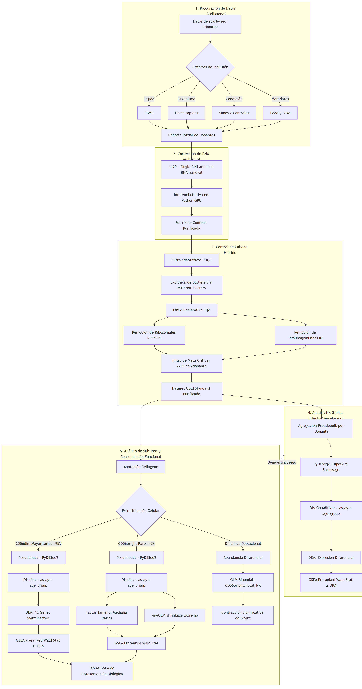

# Metodología

## Recolección y preprocesamiento de datos

El análisis se realizó con datos de tipo scRNA-seq obtenidos del repositorio *CellxGene* Census (versión LTS `2023-12-15`; CZI Cell Science Program et al., 2025), restringiendo la búsqueda a muestras de tejido sanguíneo humano provenientes de donantes sanos. Para el procesamiento y análisis computacional se emplearon rutinas desarrolladas en Python (versión 3.12.3).

La selección de las muestras se rigió por criterios de inclusión y exclusión diseñados para garantizar la calidad y la relevancia biológica del estudio. Se incluyeron únicamente datos primarios de donantes sanos con edades iguales o superiores a 34 años, cuyas células estuvieran anotadas específicamente como células NK o sus subtipos, y que contaran con metadatos completos referentes a edad y sexo. Por contraparte, se excluyeron aquellos datos provenientes de tejidos distintos a la sangre periférica, de muestras de individuos sometidos a tratamientos farmacológicos, de donantes menores de 34 años, así como cualquier célula que careciera de una anotación clara o perteneciera a linajes celulares distintos.

Para caracterizar los cambios asociados al envejecimiento, la cohorte se dividió en dos grupos de edad definidos con base en evidencia proteómica y clínica previa. El primer grupo, denominado «Adultos» (34 a 59 años), se estableció a partir del punto de inflexión molecular identificado a los 34 años en el proteoma plasmático (Lehallier et al., 2019). El segundo grupo, «Adultos Mayores» (60 años o más), se definió con base en la misma evidencia de estudios proteómicos presentada por el mismo grupo de investigación y además considerando las definiciones integrales utilizadas por la Organización Mundial de la Salud (2011, como se citó en Varela Pinedo, 2016). Esta agrupación permitió observar el paso de una fase de mantenimiento homeostático en adultos hacia una fase de senescencia inmunológica esperada en adultos mayores.

Las anotaciones de tipos celulares fueron estandarizadas y agrupadas utilizando un diccionario de ontología celular a través del CellGuide (Chan Zuckerberg Initiative, s. f.) y posteriormente adaptado de estudios recientes de perfilado de células mononucleares de sangre periférica (Hu et al., 2022). Esta estandarización permitió una comparación consistente entre conjuntos de datos a nivel de tipo celular, mientras se mantenía la granularidad de las clasificaciones de subtipos celulares. Para asegurar la calidad de los datos y la compatibilidad entre estudios, se implementó un proceso de homogeneización del espacio de características, convirtiendo todos los identificadores de genes a símbolos estándar del Comité de Nomenclatura Genética de HUGO (HGNC) y eliminando características duplicadas o ambiguas.

## Evaluación del flujo inicial sin corrección ambiental

El filtrado inicial presentó retos difíciles de superar con enfoques convencionales. Se evaluó inicialmente un diseño analítico empleando filtros de calidad estándar, parcialmente inspirado por trabajos como los de Luecken et al. (2022) o Sanbomics (2022), pero con modificaciones orientadas al control de calidad (Subramanian et al., 2022) y diseñadas para el análisis de células NK adultas, buscando asegurar la confiabilidad de los datos mientras se conservaban las señales biológicas relevantes.

No obstante, dicho enfoque reveló inconsistencias biológicas en la firma de envejecimiento. La aplicación de este flujo preliminar evidenció la aparente subexpresión con la edad de genes de cadenas pesadas y ligeras de inmunoglobulinas (cuya síntesis se limita exclusivamente a células plasmáticas y linfocitos B), a la par de una elevación espuria de factores inflamatorios característicos de granulocitos y neutrófilos. Se determinó que el ruido extracelular distorsionó los datos. Dado que las células asesinas naturales no transcriben inmunoglobulinas funcionales, se concluyó que las discrepancias observadas no reflejaban una respuesta biológica del linaje, sino la captura indiscriminada de ARN ambiental liberado por lisis celular en el tejido sanguíneo, lo que motivó el desarrollo e implementación de un diseño experimental libre de contaminación ambiental para purificar la señal nativa mediante modelado bayesiano (@fig-metodologia-flujo).

{#fig-metodologia-flujo width="70%" fig-align="center"}

*Nota.* Elaboración propia.

## Corrección del ARN ambiental (scAR) y control de calidad

La integración de múltiples estudios puso de manifiesto un sesgo relacionado con la contaminación de ARN libre o ambiental, derivado de la lisis celular durante la preparación de la suspensión unicelular. Dado que las matrices de datos carecían de los datos crudos de las gotas vacías (*empty droplets*), se empleó la herramienta *Single Cell Ambient RNA removal* (scAR, versión 0.7.0; Sheng et al., 2022) para mitigar esta contaminación cruzada. El algoritmo modela los conteos observados como una regresión binomial mixta compuesta por la señal biológica nativa y los artefactos técnicos ambientales. La corrección se ejecutó de forma estratificada por donante (`batch_key = 'donor_id'`), estimando las frecuencias relativas del perfil ambiental a partir de la expresión basal de fondo en células de baja complejidad. El entrenamiento del modelo bayesiano se realizó con 100 épocas (`epochs = 100`), tamaño de lote de 64 (`batch_size = 64`), tasa de aprendizaje de 0.001 con el optimizador Adam y aceleración computacional en GPU, derivando una matriz purificada de conteos enteros esperados a nivel de transcrito individual.

Tras la corrección probabilística, se implementó un control de calidad híbrido y riguroso. Se empleó SOLO, un método de detección de dobletes basado en aprendizaje profundo (Bernstein et al., 2020), implementado mediante el marco de trabajo scVI (scvi-tools, versión 1.1.5), entrenado sobre 5,000 genes altamente variables (`flavor = 'seurat'`) y un límite de 400 épocas con parada temprana (*early stopping*). Una célula se clasificó como doblete cuando la probabilidad estimada por SOLO superaba 0.5 y era mayor que su probabilidad de célula única. Adicionalmente, las métricas de calidad celular se calcularon utilizando un enfoque adaptativo fundamentado en la desviación absoluta de la mediana (MAD, del inglés *median absolute deviation*), aplicando un umbral de 2.5 MADs respecto a la mediana del clúster sobre el número de genes detectados y el porcentaje mitocondrial, con un corte basal mínimo de 100 genes por célula y un requisito de masa crítica de al menos 200 células por donante para su incorporación en las matrices de agregación.

La depuración reveló una bimodalidad técnica. Tras sustraer la contaminación ambiental, la distribución de genes detectados por célula (`n_genes`) manifestó una segregación bimodal que no respondía a divergencias biológicas entre subpoblaciones, sino a una partición explicada primordialmente por la química de captura (10x Genomics 3' v2 frente a 10x 3' v3), donde los transcritos ribosomales (*RPS*, *RPL*) y las inmunoglobulinas residuales actuaban como conductores del sesgo (Anexo A, sección A.2). Se aplicó un filtrado declarativo para neutralizar el artefacto.

## Modelado estadístico de la abundancia celular (GLM binomial)

Se implementó un modelo lineal generalizado (GLM, del inglés *generalized linear model*) binomial por donante. Para modelar la probabilidad de abundancia celular minimizando distorsiones espaciales, se ajustó una regresión logística tratando a cada donante como una observación biológica independiente. La variable dependiente se formuló como una matriz bivariada de recuentos ($y_i = [\text{recuento CD56bright}_i, \ \text{recuento CD56dim}_i]$), lo que pondera de manera intrínseca el tamaño total de la biblioteca celular y la profundidad muestral de cada individuo. Para aislar el efecto biológico del envejecimiento frente a posibles artefactos técnicos de secuenciación, el modelo incorporó un diseño aditivo de control por lote (`~ assay + age_group`). A partir del ajuste por máxima verosimilitud, se estimó el coeficiente logístico ($\beta$), su error estándar y la razón de momios (OR, del inglés *odds ratio*; $\text{OR} = e^\beta$) con sus intervalos de confianza al 95%. Como prueba complementaria, se comparó entre grupos de edad el cociente CD56^bright^/CD56^dim^ de cada donante mediante la prueba U de Mann-Whitney. Se prefirió el GLM porque pondera a cada donante por su número de células y ajusta por la tecnología de captura.

El modelo binomial clásico asume por definición teórica que toda la variabilidad en las proporciones celulares responde únicamente al azar del muestreo ($\phi = 1.0$). Sin embargo, en estudios clínicos y secuenciación de célula única, la marcada heterogeneidad biológica interindividual genera una dispersión empírica sustancialmente mayor que la varianza binomial esperada (sobredispersión). Asumir dispersión unitaria en estas condiciones subestima los errores estándar y genera falsos positivos al atribuir diferencias individuales basales al efecto de la edad. Para subsanar esta limitación, se implementó una corrección cuasibinomial basada en el estadístico χ² de Pearson (`scale = 'X2'`). Este procedimiento preserva los estimadores del efecto del envejecimiento ($\beta$ y OR), pero reescala la matriz de covarianzas inflando los errores estándar proporcionalmente a la varianza biológica observada. De esta forma, el contraste de hipótesis refleja con rigor la certidumbre estadística del cambio poblacional sin sobredimensionar la significancia.

## Análisis de expresión diferencial (PyDESeq2)

Para el análisis de expresión diferencial, se descartó el enfoque basado en célula única. Se ha notado que los contrastes célula a célula pueden presentar una dependencia que viola el principio de independencia estadística, lo que puede inflar los falsos descubrimientos al realizar comparaciones entre miles de células provenientes del mismo individuo como si fueran réplicas biológicas independientes (Squair et al., 2021). Para superar este obstáculo, se agregaron los recuentos enteros nativos de cada donante para cada subpoblación canónica (CD56^bright^ y CD56^dim^; Crowell et al., 2020), y para el conjunto de todas las células NK (análisis global). Las subpoblaciones corresponden a la anotación de tipo celular del Census, sin reanotación. 

Este enfoque permitió el uso de PyDESeq2 (versión 0.5.4; Muzellec et al., 2023), la implementación en Python del modelo de DESeq2 (Love et al., 2014). En cada análisis se excluyeron los ensayos sin donantes de ambos grupos de edad, se conservaron los genes con al menos 10 cuentas en al menos 3 donantes y se consideró diferencialmente expresado todo gen con $padj < 0.05$, sin umbral de log2FC (logaritmo en base 2 del cambio de expresión, del inglés *log2 fold change*). El valor $padj$ es el valor de $p$ ajustado por el método de Benjamini-Hochberg. Durante el flujo inicial de trabajo sin corrección ambiental (cuyo desarrollo se encuentra registrado en la versión preliminar del manuscrito archivada en el Anexo B, disponible en el repositorio de Git del proyecto), el análisis en *pseudobulk* mostró propensión a la inflación de falsos descubrimientos en genes de baja expresión y alta dispersión, impulsados por los desbalances de las tecnologías de captura. Para manejar estas limitaciones, se integró el modelo `~ assay + age_group` con el objetivo de aislar el efecto biológico y controlar la varianza técnica.

Aunado a lo anterior, se incorporó un ajuste mediante la técnica de contracción del cambio logarítmico (LFC *shrinkage*) mediante la función `lfc_shrink` de PyDESeq2, que aplica una distribución previa de Cauchy análoga a la del estimador apeGLM (Zhu et al., 2019). Esta regularización de cola pesada atenúa el ruido estadístico en transcritos con conteos escasos, preservando las diferencias biológicas de magnitud genuina. Este procedimiento se encontraba ausente en la versión preliminar del análisis. Su inclusión se determinó a partir de revisiones metodológicas y sobre los recientes debates del desempeño de DESeq2, en los cuales se ha señalado que omitir la contracción puede sesgar las estimaciones al sobrestimar las razones de cambio en genes con baja cobertura o alta sobredispersión (Love et al., 2014; Zhu et al., 2019). La contracción modifica solo las estimaciones de log2FC y de su error estándar; los valores de $padj$ provienen de la prueba de Wald sin contraer, por lo que el número de genes significativos no cambia.

## Análisis de enriquecimiento funcional (GSEA y ORA)

La interpretación biológica de los cambios transcripcionales se estructuró en tres análisis independientes (global, subpoblación CD56^dim^ y subpoblación CD56^bright^), combinando métodos de enriquecimiento para conjuntos completos y umbrales específicos. Inicialmente, se ejecutó un análisis de sobrerrepresentación (ORA, del inglés *over-representation analysis*) sobre los genes diferencialmente expresados del análisis global, mediante el servicio Enrichr (Kuleshov et al., 2016; consultado el 21 de septiembre de 2026) a través de gseapy (Fang et al., 2023). Se analizaron por separado los genes sobreexpresados, los subexpresados y el conjunto completo, frente a las bibliotecas Hallmark 2020 de la base de datos de firmas moleculares (MSigDB, del inglés *Molecular Signatures Database*), Biological Process 2023 de la Ontología Génica (GO, del inglés *Gene Ontology*) y Reactome 2022, con el universo de genes predeterminado de Enrichr y un umbral de $padj < 0.05$.

Dado que la firma de genes significativos es pequeña, el análisis funcional se complementó mediante un análisis de enriquecimiento de conjuntos de genes (GSEA, del inglés *gene set enrichment analysis*) en su modalidad preordenada (*preranked*) utilizando gseapy (Fang et al., 2023). Para ello, la totalidad de los genes se ordenó utilizando el estadístico de Wald derivado del modelo de PyDESeq2. Las consultas se dirigieron hacia las bibliotecas curadas de MSigDB Hallmark 2020, KEGG 2021 Human (Enciclopedia de Genes y Genomas de Kioto, del inglés *Kyoto Encyclopedia of Genes and Genomes*), Reactome 2022 y GO Biological Process 2023. El enriquecimiento se expresó como puntuación de enriquecimiento normalizada (NES, del inglés *normalized enrichment score*). Este abordaje permitió preservar las señales transcripcionales sutiles, facilitando la detección de alteraciones coordinadas a nivel de red molecular, con una tasa de descubrimientos falsos (FDR, del inglés *false discovery rate*) menor que 0.25. El GSEA se ejecutó con 1,000 permutaciones, semilla 42 y conjuntos de entre 15 y 500 genes; con ese número de permutaciones, el valor de $p$ mínimo que puede obtenerse es 0.001. Las firmas especializadas de senescencia y agotamiento se evaluaron con el mismo procedimiento, con conjuntos de entre 5 y 1,000 genes.  

En el siguiente capítulo se mostrarán los resultados obtenidos al aplicar este protocolo sobre los grupos de estudio. En él se incluye la evaluación de la dinámica y abundancia poblacional de las células NK, la firma transcriptómica de alta confianza y los perfiles de enriquecimiento funcional que definen la senescencia de las células NK.