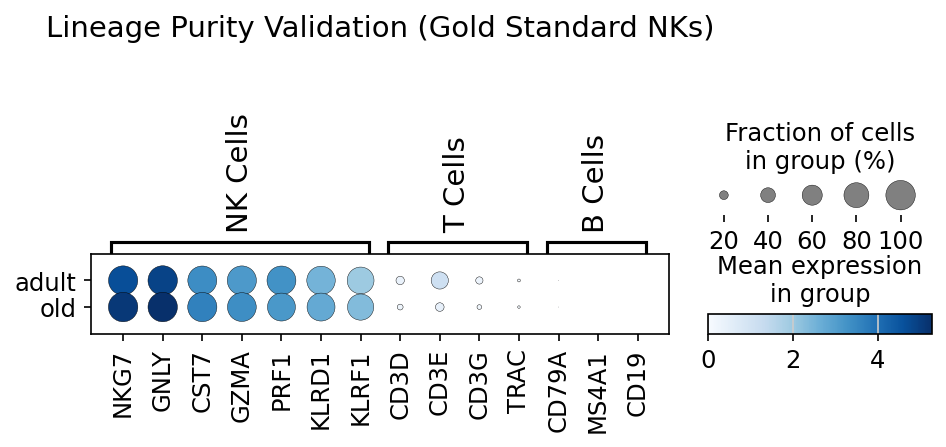
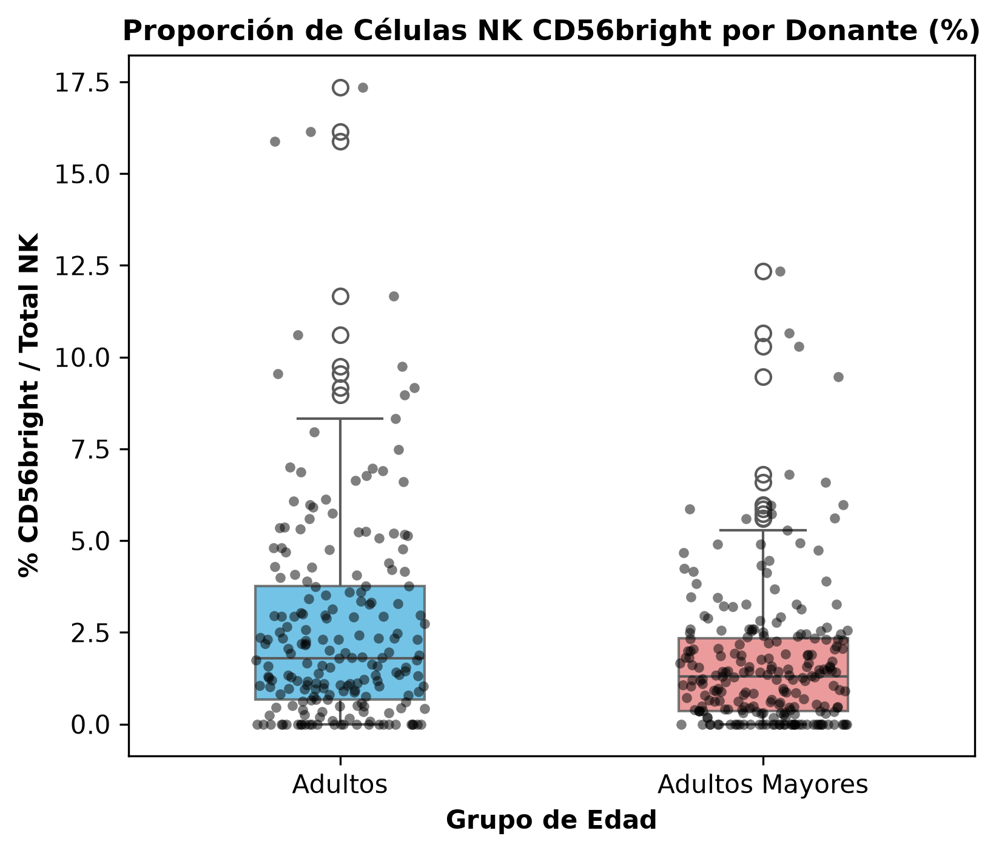
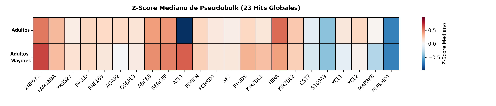
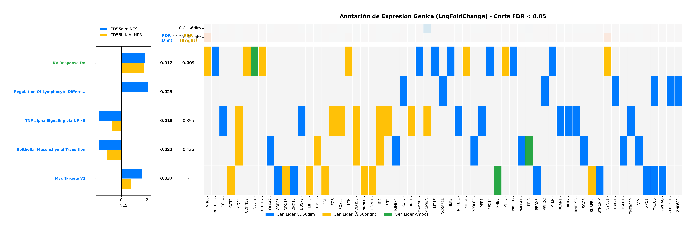
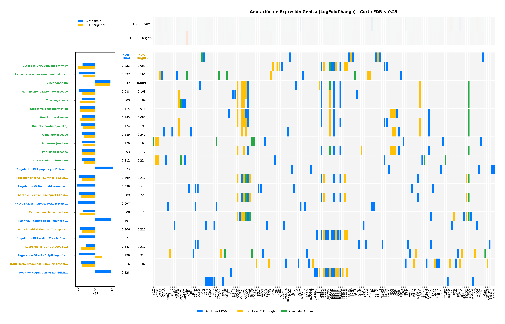

# Resultados

## Integración de la Cohorte y Purificación del Microambiente

La extracción a partir de la plataforma *CellxGene Census* (`census_version="2023-12-15"`) permitió delimitar, sobre un universo inicial de aproximadamente 45 millones de células únicas, un subconjunto de 8.8 millones correspondientes a tejido sanguíneo periférico. La aplicación sistemática de los criterios de selección en donantes sanos primarios procedentes de 14 estudios independientes (cuya relación detallada de títulos y registros DOI se compila en los Anexos), en conjunto con la remoción del ruido del ARN ambiental mediante scAR y la remoción del sesgo transcripcional ribosomal y de inmunoglobulinas, consolidó un compendio analítico de alta pureza (@fig-1). 

::: {#fig-1 layout-ncol=2}
{#fig-1a}

{#fig-1b}

Consolidación de la cohorte y purificación del microambiente NK.
:::

Este filtrado riguroso resultó en una cohorte final integrada por 143,991 células NK distribuidas en 423 donantes adultos únicos con edades iguales o superiores a 34 años (@fig-1a). La eficacia del saneamiento ambiental quedó de manifiesto mediante la reducción estadísticamente significativa de firmas espurias ajenas a la estirpe linfoide innata, destacando el silenciamiento de transcritos eritroides e inmunoglobulínicos de fondo como *HBA1* e *IGKC* (@fig-1b; reporte técnico detallado en Anexos).

## Caracterización Demográfica y Equilibrio Técnico

La estratificación por grupos de edad definió dos conjuntos biológicos contrastantes: adultos (34 a 59 años; $n = 197$ donantes, 73,434 células) y adultos mayores ($\geq 60$ años; $n = 226$ donantes, 70,557 células). Esta partición mantuvo una distribución equilibrada entre sexos, con 213 donantes de sexo femenino y 210 de sexo masculino (@tbl-demografia). La distribución continua de la variable edad garantizó una representación homogénea a lo largo de las décadas evaluadas (@fig-2a y @fig-2b).

::: {#fig-2 layout-ncol=2 layout-nrow=2}
{#fig-2a}

{#fig-2b}

{#fig-2c}

Caracterización demográfica y equilibrio técnico de la cohorte.
:::

Para descartar la influencia de efectos de lote (*batch effects*) provenientes de las plataformas de secuenciación, se validó que el uso de estas tecnologías estuviera distribuido proporcionalmente entre ambos grupos de edad (@fig-2c). Las métricas de control de calidad transcripcional (número de genes detectados, identificadores moleculares únicos y porcentaje de transcritos mitocondriales), obtenidas tras aplicar el filtrado adaptativo descrito en la metodología, se mantuvieron en umbrales óptimos para ambos grupos (@tbl-demografia); las visualizaciones y los desgloses de estas métricas técnicas se detallan en el Anexo correspondiente.

::: {#tbl-demografia tbl-colwidths="[12,9,9,14,11,9,9,9,9,9]"}
| Grupo de Edad | Donantes | Células | Edad ± DE (años) | Sexo (F / M) | UMIs (med.) | Genes (med.) | MT (%) | NK CD56dim | NK CD56bright |
|:---|:---:|:---:|:---:|:---:|:---:|:---:|:---:|:---:|:---:|
| **Adultos** | 197 | 73,434 | 46.4 ± 7.3 | 102 / 95 | 1,961 | 1,268 | 3.83 | 71,683 (97.6%) | 1,751 (2.4%) |
| **Adultos Mayores** | 226 | 70,557 | 73.5 ± 8.8 | 111 / 115 | 759 | 500 | 3.77 | 69,489 (98.5%) | 1,068 (1.5%) |
| **Total Cohorte** | **423** | **143,991** | — | **213 / 210** | — | — | — | **141,172 (98.0%)** | **2,819 (2.0%)** |

Resumen demográfico y de control de calidad transcriptómico de la cohorte.
:::

## Pureza del Linaje NK y Distribución de Subtipos

Los análisis de subconjuntos celulares se delimitaron al estudio de las dos subpoblaciones canónicas del linaje: el compartimento efector maduro CD56dim, que concentró el 98.0% de la cohorte (141,172 células), y el nicho regulador e inmaduro CD56bright, que constituyó el 2.0% restante (2,819 células) (@tbl-demografia). Los demás subtipos linfoides, tales como las células NKT, quedaron limitados al análisis exploratorio global sin ser incorporadas como subconjunto independiente.

Con el objetivo de corroborar la identidad celular y depurar posibles contaminaciones de otros linajes linfoides, se evaluó la expresión de genes marcadores canónicos derivados de las tablas ASCT+B del Atlas de Referencia Humana (Börner et al., 2021) (*lineage scoring*; p. ej., *NCAM1*, *FCGR3A*, *NKG7*, *GNLY*, *PRF1*, *KLRB1* para el linaje NK) en contraposición a firmas de células B y T (@fig-3a). La lista completa de genes marcadores empleada para esta validación fenotípica se encuentra disponible en los Anexos.

Al proyectar las 30 componentes principales de la matriz log-normalizada sin correcciones forzadas sobre un espacio UMAP bidimensional, se evidenció una estructuración espacial orientada predominantemente por el grupo etario y sus covariables técnicas asociadas (@fig-3a). Lejos de representar un obstáculo analítico, esta dispersión ratificó la necesidad de modelar explícitamente la plataforma de captura mediante formulaciones aditivas en *pseudobulk* (`~ assay + age_group`), protegiendo la varianza biológica genuina frente a cualquier homogeneización artificial. La delimitación de ambos subtipos y la variación de sus frecuencias individuales entre donantes confirmaron la preservación de las identidades fenotípicas madura e inmadura (@fig-3b y @fig-3c).

::: {#fig-3 layout-ncol=2}
{#fig-3a}

{#fig-3b}

{#fig-3c}

Pureza del linaje, proyección UMAP exploratoria y distribución de grupos de edad.
:::

## Abundancia Diferencial del Linaje e Involución del Nicho CD56bright

La dinámica demográfica de las subpoblaciones reveló una contracción pronunciada del compartimento regulador a medida que avanza la edad cronológica. El modelado mediante regresión logística generalizada (GLM) de familia binomial con ajuste por sobredispersión demostró un descenso estadísticamente concluyente en la probabilidad de abundancia de las células *NK CD56bright* en los adultos mayores frente al estrato adulto ($p < 0.0001$, coeficiente del grupo etario $\beta = -0.4702$).

Esta regresión cuantificó una contracción relativa del 37.51% en la representación de las células *CD56bright*, asociada a una razón de probabilidades (RP) de 0.6249 ($IC_{95\%} = [0.578, 0.675]$) (@fig-4). Considerando que este subconjunto constituye el productor fisiológico primordial de factores inmunomoduladores e inmunoatrayentes, particularmente IFN-$\gamma$ y las quimiocinas *XCL1* y *XCL2* (Cooper et al., 2001; Poli et al., 2009), el declive numérico observado constata una involución preferencial del brazo secretor frente a la preservación cuantitativa del compartimento citotóxico maduro.

{#fig-4 width=85% fig-align="center"}

## Expresión Diferencial de Alta Confianza (PyDESeq2) y Neutralización del Sesgo Tecnológico

El análisis transcripcional de *pseudobulk* con *PyDESeq2* permitió delimitar las alteraciones génicas vinculadas a la inmunosenescencia tomando en cuenta los artefactos de captura tecnológica. La neutralización de las diferencias técnicas (donde tecnologías de secuenciación como 10x 5' v2 introducían distorsiones artificiales de hasta un 55%) llevó a generar una matriz de datos balanceada de rango completo ($N = 187$ donantes: 152 adultos vs. 35 adultos mayores, abarcando 62,553 células). La posterior contracción bayesiana de los cambios de expresión mediante el algoritmo `apeGLM` estabilizó los estimadores de dispersión y suprimió el ruido asociado a transcritos de baja abundancia.

Con un criterio de significancia estadística ajustado por tasa de falso descubrimiento ($padj < 0.05$), el análisis identificó una firma transcripcional conformada por 23 genes diferencialmente expresados (@fig-5 y @tbl-degs-23).

::: {#tbl-degs-23 tbl-colwidths="[12,12,12,14,50]"}
| Gen | $Log_2\text{FC}$ | $p$-valor | FDR ($padj$) | Función Biológica y Linaje |
|:---|:---:|:---:|:---:|:---|
| *IL7R* | -1.0416 | 0.0000 | 0.0003 | Receptor de supervivencia y homeostasis inmadura (*CD56bright*) |
| *NKG7* | +0.8175 | 0.0001 | 0.0163 | Regulador de degranulación citotóxica efectora |
| *KLRB1* | -0.9161 | 0.0001 | 0.0163 | Receptor CD161, coestimulador y coinhibidor madurativo |
| *GZMA* | +0.9419 | 0.0003 | 0.0381 | Granzima A, serina proteasa citolítica proapoptótica |
| *TRAC* | -1.1398 | 0.0004 | 0.0381 | Cadena constante del receptor T (marcador negativo de pureza) |
| *GZMH* | +0.7063 | 0.0004 | 0.0381 | Granzima H, proteasa citotóxica lítica |
| *HLA-DRB1* | -1.0776 | 0.0004 | 0.0381 | Molécula de histocompatibilidad MHC clase II |
| *KLRG1* | +0.7583 | 0.0004 | 0.0381 | Marcador de diferenciación terminal y senescencia efectora |
| *XCL1* | -1.0967 | 0.0005 | 0.0401 | Quimiocina quimioatrayente de células dendríticas cDC1 |
| *XCL2* | -1.0827 | 0.0005 | 0.0401 | Quimiocina paráloga reclutadora de células cDC1 |
| *S100A9* | -1.6169 | 0.0006 | 0.0460 | Alarmina proinflamatoria y moduladora de estrés celular |

Genes expresados diferencialmente de alta confianza (FDR < 0.05) representativos en la cohorte de células NK, aislando la colinealidad técnica.
:::

{#fig-5 width=95% fig-align="center"}

Entre los resultados de expresión diferencial, se observó la represión coordinada del receptor de interleucina-7 (*IL7R*, $LFC = -1.0416$, $padj = 0.0003$) y de la lectina *KLRB1* ($LFC = -0.9161$, $padj = 0.0163$) en la subpoblación *CD56bright*. Asimismo, se evidenció una subexpresión significativa de las quimiocinas *XCL1* ($LFC = -1.0967$, $padj = 0.0401$) y *XCL2* ($LFC = -1.0827$, $padj = 0.0401$), moléculas responsables del reclutamiento de células dendríticas convencionales de tipo 1 (*cDC1*; Böttcher et al., 2018). Adicionalmente, tras depurar el sesgo de lote, se confirmó la represión genuina de la alarmina *S100A9* ($LFC = -1.6169$, $padj = 0.0460$), descartando el artefacto previo de hiperinflamación global.

En sentido opuesto, el conjunto de células NK maduras (*CD56dim*) exhibió una acumulación sostenida de ARN mensajero correspondiente al aparato efector lítico. Se registraron incrementos de proteasas citotóxicas como *GZMA* ($LFC = +0.9419$, $padj = 0.0381$) y *GZMH* ($LFC = +0.7063$, $padj = 0.0381$), junto con el regulador *NKG7* ($LFC = +0.8175$, $padj = 0.0163$) y el marcador de diferenciación terminal *KLRG1* ($LFC = +0.7583$, $padj = 0.0381$), indicando una acumulación de estos transcritos efectores en las células *CD56dim*.

## Enriquecimiento de Vías Transcriptómicas y Modulación Fenotípica (GSEA / ORA)

La exploración de redes biológicas y rutas moleculares mediante el análisis de enriquecimiento por conjuntos de genes (*GSEA Preranked*) empleando el estadístico de Wald del contraste en *pseudobulk* frente a las bases moleculares MSigDB Hallmark, KEGG, Reactome y GO Biological Process demostró marcadas diferencias funcionales entre los subtipos celulares (@fig-6, @fig-7 y @tbl-vias-gsea; tablas completas en Anexos).

::: {#tbl-vias-gsea tbl-colwidths="[14,14,24,9,9,10,20]"}
| Subpoblación | Categoría | Colección y Vía Transcripcional | NES | $p$-valor | FDR ($q$) | Genes Clave de Núcleo (*Core Enrichment*) |
|:---|:---|:---|:---:|:---:|:---:|:---|
| **CD56bright** | Genotóxico | UV Response Dn (Hallmark) | +1.782 | 0.0010 | 0.0087 | *CDKN1B*, *ATRX*, *PIK3CD*, *ADD3*, *CITED2*, *SYNE1* |
| **CD56bright** | Metabolismo | Oxidative Phosphorylation (KEGG) | -1.742 | 0.0010 | 0.0778 | *NDUFA6*, *NDUFS8*, *COX5B*, *UQCRFS1*, *SDHC*, *NDUFB8* |
| **CD56bright** | Metabolismo | Mitochondrial ATP Synthesis Coupled Electron Transport (GO:BP) | -1.555 | 0.0010 | 0.2098 | *ATP5F1A*, *ATP5MC1*, *COX6C*, *NDUFA4*, *UQCRQ* |
| **CD56dim** | Genotóxico | UV Response Dn (Hallmark) | +1.834 | 0.0010 | 0.0116 | *TGFBR2*, *MAPK14*, *ADD3*, *PIK3CD*, *CDKN1B*, *CITED2* |
| **CD56dim** | Inflamación | TNF-alpha Signaling via NF-kB (Hallmark) | -1.784 | 0.0010 | 0.0177 | *NFKBIA*, *TNFAIP3*, *MAP3K8*, *FOSL2*, *DUSP2*, *BIRC3* |
| **CD56dim** | Ciclo Celular | Myc Targets V1 (Hallmark) | +1.625 | 0.0010 | 0.0366 | *G3BP1*, *KPNB1*, *XPO1*, *ODC1*, *PSMD1*, *DUT*, *NPM1* |
| **CD56dim** | Metabolismo | Oxidative Phosphorylation (KEGG) | -1.698 | 0.0010 | 0.1147 | *NDUFA6*, *NDUFS8*, *COX7B*, *UQCRFS1*, *NDUFC2*, *COX5B* |
| **CD56dim** | Procesamiento | Reg. of mRNA Splicing via Spliceosome (GO:BP) | -1.876 | 0.0010 | 0.1964 | *SRSF2*, *SRSF5*, *U2AF1*, *HNRNPA1*, *SF3B1*, *MAGOH* |
| **CD56dim** | Telómeros | Reg. of Telomere Maintenance via Telomerase (GO:BP) | +1.913 | 0.0010 | 0.1912 | *XRCC5*, *TNIP1*, *PRKCQ*, *TCP1*, *CCT3*, *NEK7*, *ATM* |

Vías transcripcionales enriquecidas representativas por categoría biológica en las subpoblaciones NK CD56bright y CD56dim.
:::

El análisis de enriquecimiento funcional (GSEA) sobre el espectro continuo del estadístico de Wald reveló patrones biológicos altamente coordinados, distinguiendo entre un reloj basal compartido de estrés transcripcional y respuestas metabólicas e inflamatorias compartimentalizadas por subtipo:

1. **Estrés Genotóxico y Transcripcional Convergente (Reloj Basal Compartido):** La vía de respuesta a daño genotóxico (`MSigDB_Hallmark_UV_Response_Dn`) emergió como la única firma funcional con enriquecimiento positivo robusto y estadísticamente significativo bajo el umbral estricto ($FDR < 0.05$) en ambas subpoblaciones celulares. Dicha vía mostró una inducción simétrica tanto en células *CD56bright* ($NES = +1.782$, $p = 0.0010$, $FDR = 0.0087$) como en células *CD56dim* ($NES = +1.834$, $p = 0.0010$, $FDR = 0.0116$). Este enriquecimiento basal sostenido, impulsado por genes reguladores del ciclo celular, la cromatina y la transducción de señales como *CDKN1B*, *ATRX*, *PIK3CD*, *ADD3* y *CITED2*, evidencia un desgaste genómico universal dependiente de la edad a lo largo de todo el linaje NK.
2. **Deterioro en el Procesamiento de ARN en Células NK CD56dim y a Nivel Global:** De manera coordinada con la acumulación de estrés genotóxico, se identificó una represión transcripcional de la maquinaria de maduración y empalme alternativo del ARN mensajero. En el subtipo maduro *CD56dim*, este fenómeno se evidenció en la subregulación del espliceosoma (`KEGG_Spliceosome`, $NES = -1.708$, $FDR = 0.1253$; `GO_Regulation_Of_mRNA_Splicing_Via_Spliceosome`, $NES = -1.876$, $FDR = 0.1964$; `Reactome_mRNA_Splicing_Major_Pathway`, $NES = -1.695$, $FDR = 0.2359$). A nivel del linaje global, dicha desestabilización alcanzó una marcada represión (`GO_Positive_Regulation_Of_mRNA_Splicing_Via_Spliceosome`, $NES = -2.160$, $FDR = 0.0660$; `KEGG_Spliceosome`, $NES = -1.624$, $FDR = 0.1841$), impulsada por genes núcleo de la ribonucleoproteína nuclear y factores de empalme como *SRSF2*, *SRSF5*, *SRSF10*, *U2AF2* y *HNRNPL*.
3. **Supresión del Metabolismo Mitocondrial y Fosforilación Oxidativa:** Ambas subpoblaciones exhibieron una tendencia coordinada a la pérdida de capacidad bioenergética oxidativa, con un perfil de mayor profundidad en las células inmaduras *CD56bright* (`KEGG_Oxidative_phosphorylation`, $NES = -1.742$, $FDR = 0.0778$; `MSigDB_Hallmark_Oxidative_Phosphorylation`, $NES = -1.463$, $FDR = 0.1637$; `GO_Mitochondrial_ATP_Synthesis_Coupled_Electron_Transport`, $NES = -1.555$, $FDR = 0.2098$). En el compartimento maduro *CD56dim*, la reducción en la fosforilación oxidativa y el desacoplamiento de la cadena de transporte electrónico se mantuvo como una tendencia consistente (`KEGG_Oxidative_phosphorylation`, $NES = -1.698$, $FDR = 0.1147$; `Reactome_Respiratory_Electron_Transport`, $NES = -1.623$, $FDR = 0.2277$).

Ambos perfiles de enriquecimiento se ilustran gráficamente en el panel comparativo (@fig-6 y @fig-7). La @fig-6 exhibe las vías que superaron el umbral estricto ($FDR < 0.05$), donde destaca la inducción convergente de `UV Response Dn` frente a respuestas discordantes como la represión inflamatoria endógena de `TNF-alpha Signaling via NF-kB` ($NES = -1.784$, $FDR = 0.0177$) observada exclusivamente en las células *CD56dim*. Por su parte, la @fig-7 integra el análisis bajo umbral exploratorio ($FDR < 0.25$), permitiendo capturar el comportamiento coordinado de la desaceleración metabólica mitocondrial y la contracción en la maquinaria de empalme transcripcional. Asimismo, el panel detalla los genes que componen cada vía, lo que facilita observar si dichos genes actúan de forma exclusiva en un subtipo o si son compartidos por ambas poblaciones.

{#fig-6 width=100% fig-align="center"}

{#fig-7 width=100% fig-align="center"}

Adicionalmente, se realizó una evaluación ortogonal para contrastar el perfil transcripcional NK contra firmas establecidas de Senescencia Secretora (SASP) y Agotamiento Inmune (@tbl-sasp-exhaustion).

::: {#tbl-sasp-exhaustion tbl-colwidths="[14,22,9,10,10,18,17]"}
| Subpoblación | Firma Especializada | NES | $p$-valor | FDR ($q$) | Genes Relevantes (*Core Enrichment*) | Estado de Significancia |
|:---|:---|:---:|:---:|:---:|:---|:---|
| **CD56bright** | SASP (Reactome) | +1.503 | 0.0242 | 0.3168 | *H1-4*, *H1-3*, *CABIN1*, *UBN1*, *H1-2* | No significativo ($FDR > 0.25$) |
| **CD56dim** | SASP (Reactome) | +1.281 | 0.1844 | 0.1836 | *H1-2*, *H1-3*, *H1-4*, *ASF1A*, *TP53*, *HMGA1* | Tendencia ($FDR = 0.18$) |
| **CD56dim** | Exhausted vs Memory CD8+ T Cell (GSE9650) | +1.331 | 0.0310 | 0.2455 | *XRCC5*, *ETS1*, *PIK3CD*, *TOB1*, *KLRC1*, *IL7R* | Tendencia ($FDR = 0.24$) |

Evaluación de firmas ortogonales especializadas de senescencia secretora (SASP) y agotamiento inmune por subpoblación NK.
:::
