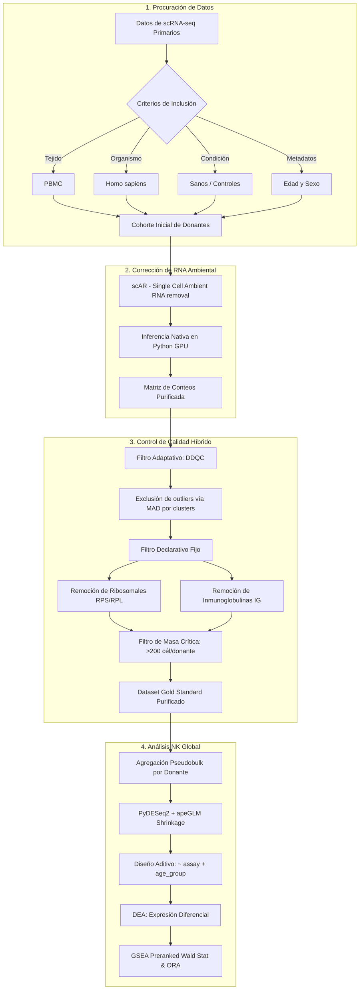

# Capítulo 7. Metodología Computacional Avanzada y Purificación de la Señal Biológica

Se diseñó el flujo de trabajo computacional para resolver uno de los problemas más críticos en el análisis de secuenciación de ARN de célula única (scRNA-seq): la separación de la señal biológica verdadera del ruido técnico (ambient RNA) y estadístico (*shot noise*). A continuación, se detalla el procesamiento algorítmico que permitió purificar los perfiles transcriptómicos de las células Natural Killer (NK) y aislar la huella transcripcional de la inmunosenescencia.

## 7.1. Mapa Metodológico del Proyecto

Se estableció una tubería bioinformática (*pipeline*) secuencial que abarcó desde la procuración de datos hasta el análisis de vías.

## 7.2. Corrección de RNA Ambiental (scAR) y Pureza de Linaje

La integración de múltiples cohortes presentó el desafío del ARN libre o ambiental ("sopa transcriptómica"), derivado de la lisis celular o del daño inducido durante la preparación de la suspensión unicelular. Durante la formación de las gotas (*droplets*) en los sistemas de microfluidos, estas moléculas exógenas se encapsulan de manera estocástica junto con las células intactas. Dado que las matrices de datos correspondían a células mononucleares de sangre periférica (PBMC) previamente filtradas —careciendo de los datos crudos de las gotas vacías (*empty droplets*)— se requirió un algoritmo para inferir el ambiente original. En consecuencia, se empleó la herramienta *Single Cell Ambient RNA removal* (scAR) (Sheng et al., 2022) para mitigar esta contaminación cruzada, particularmente de marcadores transcripcionales de células B y T adheridos artificialmente a los perfiles de las células NK.

El modelo computacional de scAR se fundamenta en la premisa de que las señales ambientales siguen una distribución predecible originada a partir del conjunto de ARN libre. El algoritmo emplea un enfoque de aprendizaje automático probabilístico basado en un Autocodificador Variacional (*Variational Autoencoder*, VAE). Matemáticamente, scAR modela los conteos observados como una regresión binomial mixta compuesta por la señal biológica nativa y los artefactos técnicos ambientales. Posteriormente, el VAE infiere simultáneamente dos variables latentes para cada célula: la tasa de ruido específica y la frecuencia de expresión nativa verdadera. 

Esta purificación molecular garantizó la eliminación del ruido a nivel de transcrito individual. En el marco metodológico, constituyó un paso indispensable para desenmascarar las alteraciones fenotípicas de la inmunosenescencia celular intrínseca y descartar señales provenientes de otros linajes.

> [!NOTE] 
> **Insertar Figura 1:** Comparativa de expresión antes y después de la corrección por scAR.

Tras la corrección algorítmica, se validó biológicamente la pureza del linaje evaluando la exclusividad de expresión de marcadores canónicos (*NCAM1*, *FCGR3A*) y confirmando la eliminación de marcadores competitivos. Se corroboró así que el fenotipo evaluado corresponde a células NK viables.

> [!NOTE] 
> **Insertar Figura 3:** Confirmación molecular de linaje, con total ausencia de marcadores competitivos.

## 7.3. Control de Calidad, Bimodalidad y Sesgo Tecnológico (Assay Bias)

La remoción del ARN ambiental reveló una distribución bimodal en el número de genes detectados por célula (`n_genes`). 

> [!NOTE] 
> **Insertar Figura 2:** Distribución original bimodal de n_genes.

Esta bimodalidad no reflejaba una división biológica subyacente, sino que se originó por un sesgo técnico inherente a las diferentes tecnologías de captura (ej. 10x Genomics 3' v2 frente a 10x 3' v3). Un análisis de componentes principales (PCA) y de partición de varianza corroboró que la variable tecnológica (`assay`) explicaba la mayor proporción de la varianza total, identificándose a los transcritos ribosomales como los principales conductores de este agrupamiento artificial.

Para mitigar este fenómeno, se ejecutaron dos estrategias sucesivas. Primero, se aplicó un filtrado declarativo para excluir los genes ribosomales y mitocondriales. Segundo, se integró una mitigación matemática mediante regresión lineal sobre el transcriptoma para extraer los residuos de expresión, ajustando por el sesgo tecnológico. Esta corrección anuló la correlación artificial dependiente de la profundidad de secuenciación, lo que permitió ordenar las células exclusivamente por su estado biológico basal. Se omitió el uso de esta regresión para normalizar la matriz de datos de manera global, ya que los análisis de expresión diferencial exigen conteos crudos. No obstante, el procedimiento validó computacionalmente la viabilidad de mitigar el sesgo asociado a la tecnología de captura.

> [!NOTE] 
> **Insertar Figura 3B:** Ruptura de la Correlación.

## 7.4. Análisis Pseudobulk y Diseño Estadístico en PyDESeq2

Para el análisis de expresión diferencial (DE), se descartó el enfoque basado en célula única (*single-cell DEA*) para prevenir la inflación de los valores *p* resultante de asumir cada célula como una réplica biológica independiente. En su lugar, se implementó una estrategia de agregación por donante (*pseudobulk*). 

Este abordaje posibilitó el uso de **PyDESeq2**. Aunque se aplicaron rigurosos filtros durante el control de calidad, los conteos brutos retenían variaciones en la profundidad de secuenciación. El modelo binomial negativo del algoritmo compensó estas discrepancias mediante la estimación de factores de tamaño (*size factors*). 

Para aislar el efecto biológico, se integró el modelo aditivo `~ assay + age_group`. Adicionalmente, para evitar la detección de falsos positivos en genes de baja expresión y alta varianza, se implementó una regularización probabilística mediante la técnica de contracción del cambio logarítmico (LFC *Shrinkage*). Específicamente, se utilizó el estimador empírico bayesiano **apeGLM** (*Approximate Posterior Estimation for GLM*) (Zhu et al., 2019), el cual asume una distribución *a priori* de Cauchy de cola pesada. A diferencia de las distribuciones normales, esta aproximación topológica encoge el ruido estadístico de transcritos con conteos escasos, preservando de manera intacta las magnitudes de cambio reales (LFC elevados). El procedimiento dotó de poder estadístico a los genes clasificados como diferencialmente expresados y eliminó la dependencia de umbrales de filtrado arbitrarios.

## 7.5. Análisis de Abundancia Diferencial Topológico (Milo)

Para modelar la dinámica poblacional y los cambios en las proporciones de los subtipos NK a lo largo del envejecimiento, se implementó el entorno estadístico Milo (Dann et al., 2020). A diferencia de las aproximaciones clásicas fundamentadas en clústeres discretos —las cuales introducen sesgos analíticos al forzar particiones en gradientes continuos— Milo evalúa la abundancia diferencial modelando los estados celulares como vecindarios (*neighborhoods*) parcialmente superpuestos sobre un grafo de *k* vecinos más cercanos (k-NN).

En el presente estudio, Milo identificó regiones específicas de la topología fenotípica (*phenotypic manifold*) que experimentaron contracción poblacional dependiente de la edad. El algoritmo cuantificó el número de células en cada vecindario representativo y empleó un Modelo Lineal Generalizado (GLM) Binomial Negativo para evaluar las diferencias de abundancia, incorporando la tecnología de captura (*assay*) en el modelo aditivo. Finalmente, se aplicó un control de Tasa de Falso Descubrimiento espacial (*Spatial FDR*) para corregir el sesgo de pruebas múltiples asociado a la superposición celular. El uso de esta topología matemática permitió cuantificar las contracciones homeostáticas con una resolución superior a las aproximaciones convencionales.

## 7.6. Análisis de Enriquecimiento de Vías (ORA y GSEA)

Para la traducción de los perfiles transcripcionales en fenotipos funcionales, se aplicaron dos metodologías complementarias. Inicialmente, se ejecutó un Análisis de Sobre-Representación (ORA) para el subconjunto de transcritos diferencialmente expresados (DEGs) significativos, identificando las rutas metabólicas prioritarias. 

Posteriormente, debido a que el filtrado de ruido técnico y la regularización estadística reducen la cantidad absoluta de DEGs puros, se utilizó la lista de genes de rango completo (*preranked gene list*) derivada de la estadística de Wald del modelo de PyDESeq2. Esta matriz sirvió como sustrato para el Análisis de Enriquecimiento de Conjuntos de Genes (GSEA). El abordaje preservó el valor de las sutilezas transcripcionales y detectó alteraciones coordinadas a nivel de red molecular. Las vías funcionales identificadas se sometieron a un filtro de significancia estadística, estableciendo la base para la interpretación de la inmunosenescencia celular.
